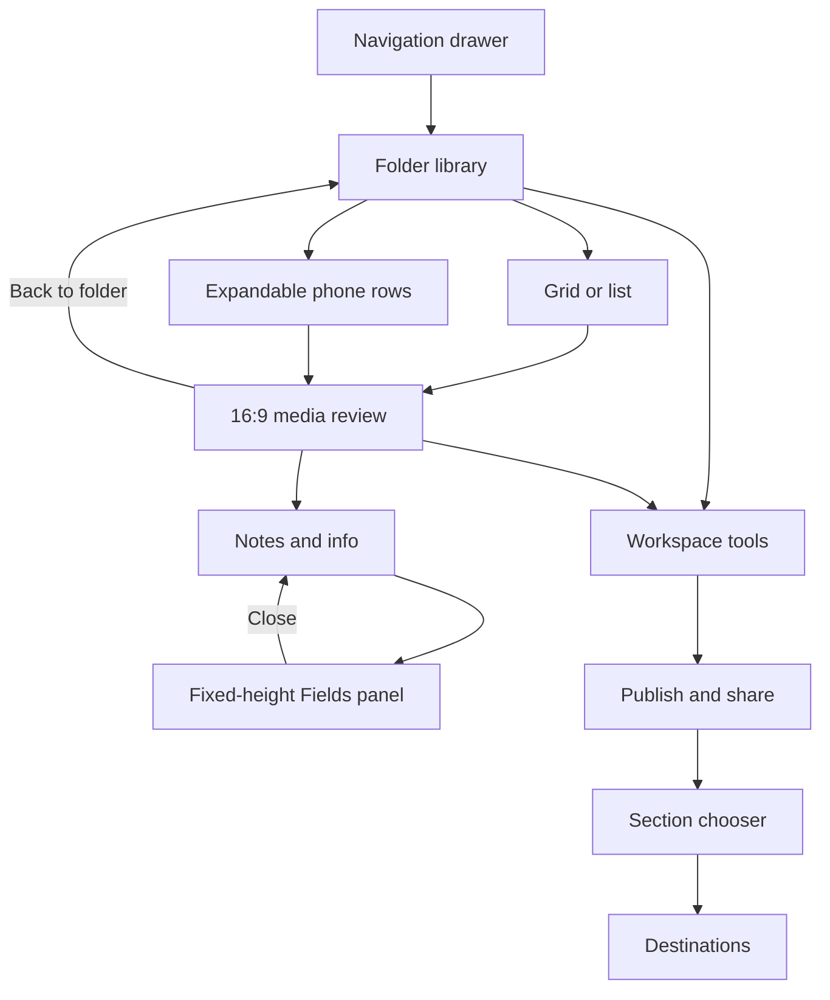

# Phone refresh review

Reviewed initial implementation `d8e4eab` against fixed point
`c8800926f60ac393d067be00e1fe2fde6f73b86f` on independent axes.
Findings below describe that reviewed revision; resolutions are in subsequent commits.

## Standards

Two documented findings and one judgement call:

- **P2, conflicting canonical spec:** obsolete toolbar and fullscreen-dialog rules
  contradicted the approved phone screen. Resolved by rewriting the superseded
  bullets in Design Spec section 15.
- **P2, phone target size:** wrapped breadcrumb buttons were 36px high. Resolved to 44px.
- **Possible duplicated code:** folder loops and table status/rating controls appeared
  in both arrangements. Resolved with shared Svelte snippets, keeping distinct layouts.

## Spec

Two P2 findings:

- Drawer Edit project could address an unmounted settings dialog. Resolved by
  opening Tools before mounting and opening its controlled project settings dialog.
  Verified from the phone drawer at 320px.
- Hidden phone table buttons preceded wider table buttons, breaking desktop focus
  restoration. Resolved by rendering only the active table arrangement. Verified
  at 1280px: closing review restored focus to asset `par-0010`, with no phone rows mounted.

## Independent bug-focused review

The requested `review-bugbot` skill is installed locally. This Codex runtime does
not expose the dedicated Bugbot service/agent type; a general independent agent
performed an explicitly identified compatibility review. This is not a native
Bugbot service check or a GitHub approval.

| Severity | Location (reviewed revision) | Finding and resolution |
|---|---|---|
| P2 | src/routes/+page.svelte:1369 | Drawer settings mount issue; fixed and verified as above. |
| P2 | src/routes/+page.svelte:806 | Inbox navigation selected Media and could leave Tools covering the note. It now selects Notes, dismisses Tools and restores notes focus below the sticky header. Verified through Notifications → Inbox → note. |
| P2 | src/routes/+page.svelte:1369 | The publishing return address could not mount its dialog. Phone `sharing=1` now opens Tools so publishing mounts and opens; verified on a fresh address load. |
| P2 | src/app.css:2139 | Copy and misfiled panel headings were omitted from the sticky treatment. Both heading classes now share the phone panel rule. |

The initial wider-table focus defect was also found by this reviewer and resolved
before its final report. Parent verification additionally fixed phone heading
scroll placement and retained the unsaved comment draft across Media/Notes switches.

These were local code reviews. There is no claim of external Bugbot or OCR approval.

## PR service status

On 2026-11-24, PR #37 was open, draft and mergeable at `c2eb40a`.
It had no submitted GitHub reviews or status checks. Greptile posted that the
organization was out of review credits, so its external review did not run:
https://github.com/gordo-v1su4/review-room-svelte/pull/37#issuecomment-7123782281

The local review evidence above remains separate. No billing, credit purchase,
merge or deployment action was taken. User UI acceptance remains pending.

## Metadata dropdown follow-up

Focused Standards and Spec reviews compared the new metadata changes against
`8b638cc`. Standards reported no findings. Spec reported two P2 findings, both
resolved and rechecked: keep incompatible asset classes visible but disabled,
with an independent callback guard; bound menu width and wrap long labels.

Native browser checks verified all four class labels and disabled still-image
choices for a video source; Nano Banana Pro selection; Custom model entry; a long
saved custom-model label wrapping without internal horizontal overflow; multiple
reference selector semantics; and Escape returning focus to its trigger. Phone
model choices were shown in the inset Asset fields panel. Reference options were
empty in this fixture, so selecting multiple actual reference images is not
claimed as browser-verified. No production metadata was saved. User UI acceptance
of this shared desktop/phone correction remains pending.

## Desktop-scope and player correction

Focused Standards and Spec reviews rechecked the changes since `a5956b2` after the
user reaffirmed original desktop geometry and an always-16:9 phone player. Both
reported no findings: desktop folder/project control geometry restored; compact
Tools and destination-select shrink rules confined to <=640px; phone frame ratio
explicitly 16:9. Native baseline comparison and phone walkthrough evidence are in
the verification record. No UI approval is inferred from these reviews.

## Current recovery and Fields verification (2026-11-24)

This supersedes earlier shared-desktop styling and sidebar-width exceptions. Desktop and intermediate layouts retain the main baseline; the new metadata select styling and image-model presets are phone-only. PR #37 is closed, unmerged. Do not create or reopen a PR until the user separately authorizes it, even after UI approval.

The phone Fields dialog now has fixed 80dvh height. Its heading, centered group controls, search/completeness controls and save footer stay anchored; only the fields scroll. The six groups were switched through in the real signed-in local app at 430 x 768: every dialog had top 76.8359375 and height 614.6614379882812 CSS pixels. Media/Notes now use restrained underline tabs. Decision-button sizing remains unchanged at the user's request.

Spec review of the final Fields layout reported no findings. The compatibility bug-focused review of the preceding recovery reported no actionable bugs; this is local agent evidence, not a native Bugbot approval. Final check: zero errors and eight existing warnings; build passed. Existing test suite: 330 passed. No new test seam was introduced.

Actual existing media playback and previous/next asset navigation were verified without metadata/status/rating edits. Phone review fit 430 x 768 and 320 x 640 without page overflow. Unauthenticated owner-version-metadata GET/POST now return JSON 401 rather than redirected HTML. After the production build, the dev listener was restarted to clear its stale generated-module state; the visible signed-in phone preview then loaded successfully. The temporary baseline comparison listener was stopped.

Rendered evidence is outside Git under C:/Users/Gordo/.codex/visualizations/2026/11/24/01a20be2-920f-75c1-9f99-d29aac742621/mobile-proof/: phone-fields-all.jpg, phone-fields-tags.jpg, phone-review.jpg, plus earlier published/local desktop comparisons. The full All panel image was visually inspected. The native browser is left on the phone Fields panel. Physical-phone and user UI acceptance remain pending; no PR, push, merge or deployment was performed during this recovery.

## Compact controls follow-up

User rejected underline tabs and bulky touch dropdowns. Phone Media/Notes now use borderless rounded fill selection; dropdowns retain compact11px/28px styling on touch devices. Table Status/Rating use PhoneSelect only in the phone branch. The table bookmark is icon-only with its accessible label retained. Phone panel scrollbar styling matches the existing thin20%-opacity token. Main drawer and wider table/native selects remain unchanged.

Focused Spec source review reported no actionable findings: existing status/rating/shortlist callbacks and values retained, archived display disabled, no desktop/intermediate leakage. Native UI verified compact option geometry and icon-only bookmark, table expansion and review/back retention, and publishing width fit at320/430. Latest check: zero errors/eight existing warnings. User approval and separate PR authorization remain pending. The original main CSS is still preserved verbatim as a prefix of app.css (normalized line endings), with scoped additions after it.
# Current review handoff

Local checkpoint: `2f94613` on `codex/review-room-next`. PR #37 is closed, unmerged. This summary supersedes historical implementation notes below. No PR creation/reopening, push, merge or deployment is authorized by UI approval alone.

The phone refresh (<=640px) separates folder browsing from media review, groups secondary actions under Tools, and uses inset publishing/Fields panels. Wider layouts retain the published baseline. Media/Notes selectors now use rounded background highlights with no underline or selection border. Phone dropdowns use compact 11px text/28px rows; bookmarks are icon-only. Fields groups remain centered and their panel stays fixed while contents scroll.

Validation: latest type check has zero errors/eight existing warnings; latest production build passed. The existing suite previously passed 330 tests. Svelte autofixer reports no issues for the final table and phone select components. Focused Spec review found no actionable issues in the final compact-control changes. Local bug-focused review is compatibility evidence, not native Bugbot approval; the earlier external Bugbot review could not run because of review credits.

Rendered evidence covers real signed-in media playback, asset previous/next, Back to folder, table expansion retention, fixed Fields groups, publishing sections and no horizontal overflow at 320/430px. The main stylesheet's baseline prefix remains unchanged. No production publishing or metadata/status/rating changes were performed for verification.

Acceptance still required: browsing, review navigation and metadata, Tools/publishing, phone table, final overall UI and physical-phone confirmation. The drawer and compact stars/bookmark appearance have explicit user approval. Do not infer approval of another screen from those approvals. Run the installed retro after the separately authorized PR step, as requested.

---

